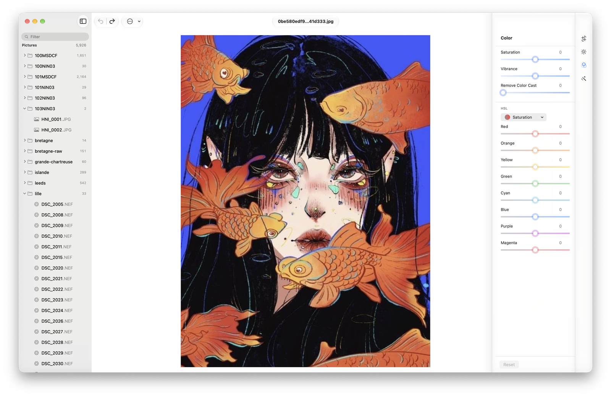

# Photon

Simple image editor for people who want to get things done.

Photon is a local-first editor for macOS and iPadOS. Open a folder of photos,
adjust and crop them, and keep the originals untouched. Everything runs on your
device: no account, no cloud.



## Features

- Open a folder directly, with no library import
- Browse with a quick name filter and keyboard navigation
- Color adjustments: saturation, vibrance, cast, and per-color HSL
- Crop with aspect ratios and rotation
- Per-photo undo and redo
- RAW support through Core Image
- GPU-backed previews

## Status and roadmap

Photon is in early development. Everything related to photo editing, including
the tools, layout, and workflow, is subject to change. Light and Presets are
placeholders, edits are currently in-memory, and export is not available yet.

Export is next, followed by film-emulation filters that can be created,
imported, and applied. Both are still being designed, and the details may
change.

## Requirements

- macOS 27+ or iPadOS 27+
- Xcode 27 and [XcodeGen](https://github.com/yonaskolb/XcodeGen) to build from source

## Build

```sh
xcodegen generate
open Photon.xcodeproj
```

Run the **Photon** scheme on My Mac or an iPad simulator.

## Feedback

Bug reports are welcome in the [issue tracker](https://github.com/QuadraAI/photon/issues).

Photon is a personal project. It is not mature enough for outside code
contributions yet, and I'm not accepting them for security reasons. Please
report bugs instead of opening pull requests.

## License

A license hasn't been chosen yet.
